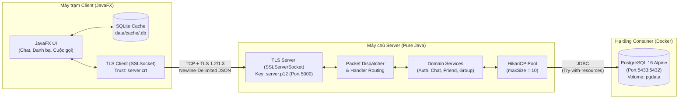

# Zalo Clone (Secure TCP Chat)

Ứng dụng nhắn tin Desktop phong cách Zalo dành cho môn học **Lập trình Mạng**, xây dựng trên nền tảng **Java 17+**, **TLS Socket** (`SSLServerSocket` / `SSLSocket`), **JavaFX 21**, **PostgreSQL 16** (Docker) phía máy chủ và **SQLite** bộ nhớ đệm cục bộ phía máy trạm.

---

## 📑 Mục lục tài liệu

- 📘 **README tổng hợp (Tài liệu này):** Hướng dẫn cài đặt, cấu hình, DevOps và vận hành toàn hệ thống.
- 📙 **[Common Module README](zalo-common/README.md):** Định nghĩa chi tiết giao thức Newline-Delimited JSON, mã lỗi, gói tin `Packet` và các `DTO`.
- 📗 **[Server Module README](zalo-server/README.md):** Kiến trúc 4 tầng, đa luồng, connection pool HikariCP, cơ chế bảo mật BCrypt và lưu trữ cơ sở dữ liệu.
- 📕 **[Client Module README](zalo-client/README.md):** Kiến trúc JavaFX, xác thực chứng chỉ TLS, xử lý luồng nhận bất đồng bộ, bộ nhớ đệm SQLite offline.
- 📐 **[ARCHITECTURE.md](ARCHITECTURE.md):** Bản thiết kế kiến trúc kỹ thuật chi tiết và các nguyên tắc bảo mật.
- 🗺️ **[ROADMAP.md](docs/ROADMAP.md):** Lộ trình phát triển 13 bước và tiêu chí nghiệm thu từng tính năng.

---

## 1. Kiến trúc Hệ thống & Luồng Dữ liệu



### Nguyên tắc vận hành cốt lõi:
1. **Không dùng framework nặng:** Sử dụng socket thuần Java (`javax.net.ssl`), đa luồng với `ExecutorService` (không dùng Spring, Netty) theo đúng tinh thần môn học Lập trình mạng.
2. **Kênh truyền mã hoá tuyệt đối:** Mọi gói tin (đăng ký, đăng nhập, tin nhắn, tìm bạn) đều phải đi qua kết nối TLS an toàn.
3. **Phân quyền truy cập cơ sở dữ liệu:** Chỉ Server mới kết nối tới PostgreSQL. Client tuyệt đối không có tài khoản DB và không nối trực tiếp vào DB.
4. **Bộ nhớ đệm thông minh:** Khi mất mạng, Client vẫn đọc được toàn bộ tin nhắn từ SQLite cục bộ; khi có mạng trở lại, Client đồng bộ gia số theo mốc `last_message_id`.

---

## 2. Bảng Tính năng & Điểm Nghiệm thu

| Tính năng | Mô tả chi tiết | Thành phần chịu trách nhiệm |
|---|---|---|
| **Xác thực bảo mật** | Đăng ký, đăng nhập, băm mật khẩu BCrypt (rounds 12), khoá 60s khi sai 5 lần. | `AuthService`, `PasswordHasher`, `LoginAttemptLimiter` |
| **Tìm kiếm & Kết bạn** | Tìm người dùng bằng **Số điện thoại**, gửi lời mời kết bạn, danh sách chờ duyệt, chấp nhận/từ chối, thông báo realtime. | `FriendClient`, `FriendHandler`, `FriendService` |
| **Chat 1-1 (Direct)** | Nhắn tin trực tiếp giữa 2 người, định tuyến realtime nếu người nhận online, lưu DB an toàn nếu offline. | `ChatClient`, `ChatHandler`, `MessageService` |
| **Chat Nhóm (Group)** | Tạo nhóm, thêm thành viên, xoá thành viên, rời nhóm, broadcast tin nhắn tới toàn bộ thành viên. | `GroupService`, `GroupHandler`, `MainController` |
| **Trạng thái (State)** | Chấm xanh Online / Xám Offline thời gian thực. Đánh dấu đã gửi (✓), đã nhận (✓✓), đã đọc (✓✓ xanh). | `PresenceService`, `ReceiptNotifier`, `MarkSeenHandler` |
| **Lịch sử & Phân trang** | Cuộn lên tải thêm tin cũ (`beforeId`), đồng bộ tin mới (`afterId`), xem offline không cần mạng. | `HistoryHandler`, `MessageCache`, `ChatController` |
| **Thời gian & Người gửi** | Hiển thị mốc thời gian chuẩn (`HH:mm`, `dd/MM/yyyy`), avatar, tên hiển thị người gửi. | `TimeUtil`, `MessageCell`, `ConversationCell` |

---

## 3. Cấu trúc Dự án

```
ZaloClone/
├── pom.xml                         # Parent POM đa module (Java 17, dependencies)
├── docker-compose.yml              # Cấu hình container PostgreSQL 16
├── .env.example                    # File mẫu biến môi trường bảo mật
├── .gitignore                      # Chặn *.p12, *.key, .env, data/, logs/
├── ARCHITECTURE.md                 # Tài liệu kiến trúc chuyên sâu
├── BUSINESS_SPEC.md                # Đặc tả nghiệp vụ
├── README.md                       # Tài liệu tổng thể dự án
├── scripts/                        # Thư mục scripts tiện ích
│   ├── gen-certs.sh                # Sinh chứng chỉ TLS (Linux/macOS)
│   ├── gen-certs.bat               # Sinh chứng chỉ TLS (Windows CMD)
│   ├── run-server.ps1              # Chạy Server tự nạp .env (Windows PowerShell)
│   └── run-server.bat              # Chạy Server tự nạp .env (Windows CMD)
│
├── zalo-common/                    # Thư viện giao thức & DTO dùng chung
│   ├── pom.xml
│   └── src/main/java/com/example/zalo/common/
│       ├── model/                  # UserDto, MessageDto, ConversationDto, FriendRequestDto
│       ├── protocol/               # Packet, MessageType, ErrorCode, ProtocolConstants
│       └── util/                   # JsonUtil (Jackson), TimeUtil
│
├── zalo-server/                    # Máy chủ TLS, nghiệp vụ & kết nối PostgreSQL
│   ├── pom.xml
│   ├── certificates/               # Chứa server.p12 (Private key - KHÔNG commit)
│   └── src/main/
│       ├── java/com/example/zalo/server/ (net, handler, service, repository, config)
│       └── resources/              # server.properties, schema.sql, logback.xml
│
└── zalo-client/                    # Ứng dụng JavaFX Desktop Client
    ├── pom.xml
    ├── certificates/               # Chứa server.crt (Public certificate - được commit)
    ├── data/cache/                 # Chứa <username>.db (SQLite offline cache)
    └── src/main/
        ├── java/com/example/zalo/client/ (net, service, cache, ui/controller, ui/component)
        └── resources/              # client.properties, cache-schema.sql, fxml/, css/
```

---

## 4. Hướng dẫn Cài đặt Công cụ (Tooling Setup)

### 4.1 Cài đặt Java Development Kit (JDK 17 trở lên)
Dự án yêu cầu **JDK 17** tối thiểu (tương thích tốt với JDK 17, 21, 24).
1. Tải bộ cài JDK từ [Oracle JDK](https://www.oracle.com/java/technologies/downloads/) hoặc [Eclipse Temurin](https://adoptium.net/).
2. **Cấu hình biến môi trường `JAVA_HOME` (Rất quan trọng):**
   - **Trên Windows:**
     - Mở *Start* -> Gõ *Environment Variables* (Biến môi trường hệ thống).
     - Tại mục *System variables*, chọn *New*:
       - Variable name: `JAVA_HOME`
       - Variable value: Đường dẫn tới thư mục JDK (Ví dụ: `C:\Program Files\Java\jdk-24` hoặc `C:\Program Files\Java\jdk-17`).
     - Chọn biến `Path` -> Bấm *Edit* -> Thêm dòng: `%JAVA_HOME%\bin`.
   - **Trên macOS / Linux:**
     Thêm vào file `~/.bashrc` hoặc `~/.zshrc`:
     ```bash
     export JAVA_HOME=$(/usr/libexec/java_home -v 17) # trên macOS
     # hoặc: export JAVA_HOME=/usr/lib/jvm/java-17-openjdk # trên Linux
     export PATH=$JAVA_HOME/bin:$PATH
     ```
3. **Kiểm tra cài đặt:**
   ```bash
   java -version
   # Output phải hiển thị version >= 17
   ```

### 4.2 Cài đặt Apache Maven (3.9 trở lên)
1. Tải Maven từ [maven.apache.org](https://maven.apache.org/download.cgi).
2. Thêm thư mục `bin` của Maven vào biến `Path`.
3. **Kiểm tra cài đặt:**
   ```bash
   mvn -v
   # Output hiển thị Apache Maven 3.9+ và Java version nhận đúng JAVA_HOME
   ```

### 4.3 Cài đặt Docker & Docker Compose
Docker được sử dụng để chạy máy chủ cơ sở dữ liệu **PostgreSQL 16**.
1. Cài đặt **Docker Desktop** (trên Windows / macOS) hoặc **Docker Engine + Docker Compose** (trên Linux).
2. Khởi chạy Docker Desktop và đảm bảo Docker engine đã sẵn sàng (`Engine running`).
3. **Kiểm tra cài đặt:**
   ```bash
   docker --version
   docker compose version
   ```

---

## 5. Cấu hình Kết nối & Bảo mật (Setup Connect & Secrets)

### 5.1 Cấu hình Biến Môi trường (`.env`)
Dự án tuyệt đối không hardcode mật khẩu vào file nguồn. Bạn cần tạo file cấu hình môi trường `.env`:

1. Sao chép từ file mẫu:
   ```bash
   # Trên Linux/macOS
   cp .env.example .env
   # Trên Windows CMD/PowerShell
   copy .env.example .env
   ```
2. Mở file `.env` và thiết lập các thông số bảo mật:
   ```env
   DB_USER=zalo_app
   DB_PASSWORD=MatKhauDatabase123!@#
   CHAT_CERT_PASSWORD=MatKhauChungChi456!@#
   ```
   > ⚠️ **Lưu ý bảo mật:** File `.env` chứa mật khẩu thực tế và đã được khai báo trong `.gitignore`. Không bao giờ commit file này lên Git.

---

### 5.2 Khởi tạo Chứng chỉ TLS (Keytool)
Hệ thống sử dụng cơ chế bảo mật khóa công khai (PKI):
- Server sở hữu Keystore bí mật `server.p12` (chứa Private Key + Certificate).
- Client chỉ cần chứng chỉ công khai `server.crt` để xác thực Server.

Chạy script tạo chứng chỉ tự động:
- **Trên Windows:**
  ```cmd
  set CHAT_CERT_PASSWORD=MatKhauChungChi456!@#
  scripts\gen-certs.bat localhost
  ```
- **Trên Linux / macOS:**
  ```bash
  export CHAT_CERT_PASSWORD=MatKhauChungChi456!@#
  chmod +x scripts/gen-certs.sh
  ./scripts/gen-certs.sh localhost
  ```

*Kết quả sinh ra:*
- `zalo-server/certificates/server.p12` (Được giấu kín ở Server).
- `zalo-client/certificates/server.crt` (Được cung cấp cho Client).

---

### 5.3 Cấu hình Mạng & Các Cổng Kết nối (Ports)

| Dịch vụ | Cổng mặc định | Giao thức | Phạm vi truy cập |
|---|---|---|---|
| **Zalo Chat TLS** | `5000` | TCP + TLS | `0.0.0.0:5000` (Mở cho tất cả client kết nối) |
| **PostgreSQL Database**| `5433` (Host) ➔ `5432` (Container) | TCP | `127.0.0.1:5433` (Chỉ cho phép kết nối nội bộ từ máy chạy Server) |

#### Kết nối qua mạng LAN (giữa 2 máy tính khác nhau):
Nếu Server ở **Máy A** (`192.168.1.50`) và Client ở **Máy B**:
1. Tại Máy A, sinh chứng chỉ TLS có kèm IP nội bộ:
   ```bash
   ./scripts/gen-certs.sh 192.168.1.50
   ```
2. Copy file `zalo-client/certificates/server.crt` từ Máy A sang Máy B.
3. Trên Máy B, sửa file `zalo-client/src/main/resources/client.properties`:
   ```properties
   server.host=192.168.1.50
   tls.expectedHost=192.168.1.50
   ```
4. Đảm bảo Firewall trên Máy A cho phép kết nối vào cổng `5000`.

---

## 6. Hướng dẫn DevOps & Hạ tầng Container

### 6.1 Quản lý Dịch vụ Database (PostgreSQL)
Dịch vụ PostgreSQL được định nghĩa trong `docker-compose.yml`:
```yaml
services:
  postgres:
    image: postgres:16-alpine
    container_name: zalo-postgres
    restart: unless-stopped
    environment:
      POSTGRES_DB: zalo
      POSTGRES_USER: ${DB_USER}
      POSTGRES_PASSWORD: ${DB_PASSWORD}
      TZ: Asia/Ho_Chi_Minh
    ports:
      - "127.0.0.1:5433:5432"
    volumes:
      - pgdata:/var/lib/postgresql/data
    command: ["postgres", "-c", "max_connections=50"]
    healthcheck:
      test: ["CMD-SHELL", "pg_isready -U ${DB_USER} -d zalo"]
      interval: 5s
      timeout: 3s
      retries: 10
volumes:
  pgdata:
```

**Các lệnh thao tác:**
- **Khởi động database chạy nền:**
  ```bash
  docker compose up -d
  ```
- **Kiểm tra trạng thái container (đảm bảo báo `healthy`):**
  ```bash
  docker compose ps
  ```
- **Xem nhật ký log database:**
  ```bash
  docker compose logs -f postgres
  ```
- **Dừng database:**
  ```bash
  docker compose down
  ```
- **Xóa trắng dữ liệu để làm lại từ đầu (Reset volume):**
  ```bash
  docker compose down -v
  ```

---

## 7. Hướng dẫn Biên dịch & Chạy Ứng dụng (Step-by-Step Run Guide)

Thực hiện lần lượt theo 5 bước dưới đây để chạy hệ thống từ con số 0:

### Bước 1: Khởi động Database
```bash
docker compose up -d
docker compose ps
# Chờ cột STATUS hiển thị (healthy)
```

### Bước 2: Tạo chứng chỉ bảo mật TLS
- **Windows:**
  ```cmd
  set CHAT_CERT_PASSWORD=MatKhauChungChi456!@#
  scripts\gen-certs.bat localhost
  ```
- **Linux/macOS:**
  ```bash
  export CHAT_CERT_PASSWORD=MatKhauChungChi456!@#
  ./scripts/gen-certs.sh localhost
  ```

### Bước 3: Biên dịch toàn bộ dự án
Tại thư mục gốc `ZaloClone`:
```bash
mvn clean package
```
> *Quá trình biên dịch sẽ tạo file thực thi Fat Jar `zalo-server/target/zalo-server.jar` và các file thư viện.*

---

### Bước 4: Khởi động Zalo Server

- **Cách 1: Sử dụng script tự động nạp môi trường (Khuyến nghị):**
  - Trên Windows (PowerShell):
    ```powershell
    .\scripts\run-server.ps1
    ```
  - Trên Windows (CMD):
    ```cmd
    scripts\run-server.bat
    ```
- **Cách 2: Chạy trực tiếp qua lệnh Java:**
  - Trên Windows PowerShell:
    ```powershell
    $env:DB_USER = "zalo_app"
    $env:DB_PASSWORD = "MatKhauDatabase123!@#"
    $env:CHAT_CERT_PASSWORD = "MatKhauChungChi456!@#"
    java -jar zalo-server\target\zalo-server.jar
    ```
  - Trên Linux / macOS:
    ```bash
    export DB_USER=zalo_app
    export DB_PASSWORD=MatKhauDatabase123!@#
    export CHAT_CERT_PASSWORD=MatKhauChungChi456!@#
    java -jar zalo-server/target/zalo-server.jar
    ```

Khi Server khởi động thành công, màn hình sẽ thông báo:
```text
INFO com.example.zalo.server.ServerMain - DB connected, schema ready
INFO com.example.zalo.server.ServerMain - TLS context loaded
INFO com.example.zalo.server.ServerMain - TLS chat server listening on 0.0.0.0:5000
```

---

### Bước 5: Khởi động Zalo Client & Trải nghiệm Chat Đa người dùng

Để kiểm tra hệ thống hoạt động đầy đủ, mở **2 cửa sổ dòng lệnh riêng biệt** để khởi động 2 Client:

#### 🖥️ Khởi động Client 1 (Người dùng A):
```bash
mvn -pl zalo-client javafx:run
```
1. Chọn **Đăng ký tài khoản**:
   - Tên đăng nhập: `user_a`
   - Mật khẩu: `123456`
   - Tên hiển thị: `Nguyễn Văn A`
   - Số điện thoại: `0901111222`
2. Bấm **Đăng ký** rồi quay lại đăng nhập.

#### 🖥️ Khởi động Client 2 (Người dùng B):
Mở một cửa sổ Terminal mới:
```bash
mvn -pl zalo-client javafx:run
```
1. Chọn **Đăng ký tài khoản**:
   - Tên đăng nhập: `user_b`
   - Mật khẩu: `123456`
   - Tên hiển thị: `Trần Thị B`
   - Số điện thoại: `0909999888`
2. Đăng nhập vào hệ thống.

---

### 🧪 Kịch bản Kiểm thử Nghiệm thu Tính năng

1. **Kết bạn qua Số điện thoại:**
   - Tại màn hình của `user_a`, chọn tab **Danh bạ** (icon Danh bạ ở thanh menu trái).
   - Nhập số điện thoại của `user_b`: `0909999888` -> Bấm nút **Tìm kiếm**.
   - Thông tin `Trần Thị B` xuất hiện -> Bấm **Kết bạn**.
   - Cửa sổ của `user_b` sẽ nhận được thông báo lời mời kết bạn ngay lập tức -> Bấm **Đồng ý**.
2. **Nhắn tin Trực tiếp (Direct Chat):**
   - Cả hai người dùng giờ đã có tên nhau trong danh bạ và mục tin nhắn.
   - Nhắn tin qua lại: kiểm tra tin nhắn hiển thị tức thì, thời gian gửi, avatar và tên người gửi.
   - Quan sát dấu trạng thái:
     - Tin nhắn gửi đi hiển thị dấu ✓ (`SENT`).
     - Khi bên kia nhận được hiển thị dấu ✓✓ (`DELIVERED`).
     - Khi bên kia bấm vào xem hội thoại, dấu chuyển sang màu xanh dương (`SEEN`).
3. **Tạo Nhóm Chat (Group Chat):**
   - Bấm nút **Tạo nhóm** -> Đặt tên nhóm (ví dụ: `Nhóm Bài Tập LTM`) -> Chọn các thành viên và xác nhận.
   - Nhắn tin trong nhóm: Tất cả thành viên trong nhóm nhận được tin nhắn đồng thời.
4. **Kiểm tra Bộ nhớ đệm Ngoại tuyến (Offline Cache):**
   - Đóng hoàn toàn Server (hoặc tắt kết nối mạng).
   - Mở Client lên hoặc chuyển qua lại giữa các hội thoại: Lịch sử tin nhắn vẫn hiển thị đầy đủ từ SQLite (`data/cache/<user>.db`).
   - Màn hình thông báo: *"Đang offline: hiển thị lịch sử đã lưu"*. Nút gửi tin nhắn tự động bị vô hiệu hóa để bảo vệ tính toàn vẹn dữ liệu.

---

## 8. Xử lý Sự cố Thường gặp (Troubleshooting)

| Lỗi gặp phải | Nguyên nhân gốc | Hướng dẫn xử lý |
|---|---|---|
| `The JAVA_HOME environment variable is not defined correctly` | Maven không tìm thấy JDK hoặc biến `JAVA_HOME` chưa được cấu hình. | Thiết lập biến môi trường `JAVA_HOME` trỏ tới thư mục JDK (ví dụ: `set JAVA_HOME=C:\Program Files\Java\jdk-24` hoặc cấu hình vĩnh viễn trong System Variables). |
| `Connection refused: connect` | Server chưa chạy, sai cổng kết nối, hoặc Firewall chặn. | Đảm bảo Server đã khởi động thành công và cổng `5000` đang mở (`netstat -ano \| findstr 5000`). |
| `SSLHandshakeException: No name matching localhost found` | Hostname truy cập không khớp với Common Name (CN) hoặc Subject Alternative Name (SAN) trong chứng chỉ. | Sinh lại chứng chỉ bằng script `gen-certs` với đúng tên host hoặc IP bạn kết nối tới (`scripts\gen-certs.bat <host>`). |
| `password authentication failed for user` | Mật khẩu database trong `.env` không khớp với mật khẩu lúc tạo container PostgreSQL ban đầu. | Chạy lệnh `docker compose down -v` để xóa volume cũ, sau đó chạy lại `docker compose up -d` với mật khẩu mới trong `.env`. |
| `Bind for 0.0.0.0:5433 failed: port is already allocated` | Cổng 5433 trên máy bạn đang bị chiếm dụng bởi một phần mềm khác. | Mở `docker-compose.yml` và đổi cổng host từ `5433:5432` thành một cổng khác (ví dụ: `5434:5432`), sau đó cập nhật `db.url` trong `server.properties`. |
| `Error: Could not find or load main class` | Chưa biên dịch dự án hoặc thư mục `target` bị thiếu. | Chạy lại lệnh `mvn clean package` từ thư mục gốc dự án. |
